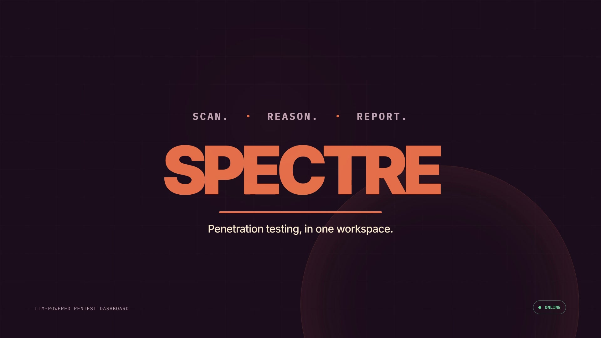

# SPECTRE


SPECTRE is an LLM-powered penetration testing framework for planning authorised assessments, running real security tools, parsing their output into structured findings, and generating professional reports.

> **Authorised use only:** Only scan systems you own or have explicit written permission to test.

## Features

- AI-assisted chat powered by Groq using `openai/gpt-oss-20b`.
- Real `nmap` and `nikto` tool calls from chat—scan output is never simulated.
- Persistent chat history, streamed responses, cancellation, and activity indicators.
- Target-list import from `.txt`, `.csv`, and `.docx` files.
- Batch engagements with live per-target status and NDJSON output streaming.
- Finding extraction, severity classification, and engagement tracking.
- Markdown penetration-test reports scoped to one engagement or all findings.
- Downloadable and copyable reports persisted in the browser.
- A local tool console for Nmap, Nikto, WPScan, theHarvester, enum4linux, dnsrecon, SearchSploit, Masscan, John the Ripper, Lynis, sslscan, and NetExec/CrackMapExec.
- Offline mode and light, dark, and system themes.

## Architecture

```text
app/
├── api/chat/              Groq chat and tool-calling flow
├── api/engagement/        Sequential batch scanning and NDJSON progress
├── api/report/            Finding aggregation and report generation
├── api/tools/             Tool discovery and execution routes
├── chat/                  Chat, target import, engagement, and report UI
├── reports/               Standalone report view
└── tools/                 Local security-tool console

components/targets/        Target parsing, importing, and live batch table
lib/chatStore.ts           Browser-persisted conversations
lib/store.ts               Server-side scans, findings, and engagements
lib/tools.ts               Tool registry and safe spawn-based execution
```

The API routes use the Next.js Node.js runtime because security tools are executed with `child_process.spawn`. SPECTRE should therefore run on a Linux host, VM, or container where the required binaries are installed. A typical serverless deployment cannot provide these subprocesses or durable local storage.

## Requirements

- Node.js 18 or newer.
- npm.
- A Groq API key.
- Linux or Kali Linux for local tool execution.
- `nmap` and `nikto` for chat-driven and batch scans.
- Any additional binaries you want to use from the Tools page.

On Debian, Ubuntu, or Kali, the core tools can be installed with:

```bash
sudo apt update
sudo apt install nmap nikto
```

The Tools page detects installed binaries and displays an installation hint for anything missing. Some tools, such as Masscan and Lynis, may require elevated privileges for their full functionality.

## Setup

Install dependencies:

```bash
npm install
```

Create the local environment file:

```bash
cp .env.local.example .env.local
```

At minimum, configure:

```dotenv
GROQ_API_KEY=gsk_your_key_here
```

Optional server configuration:

```dotenv
# Override the JSON data-store location.
SPECTRE_STORE_PATH=/absolute/path/to/store.json

# Override binary paths, useful for containers or tests.
SPECTRE_NMAP_BIN=/usr/bin/nmap
SPECTRE_NIKTO_BIN=/usr/bin/nikto

# Override the Groq-compatible endpoint used by report generation.
SPECTRE_GROQ_URL=https://api.groq.com/openai/v1/chat/completions
```

Start the development server:

```bash
npm run dev
```

Open [http://localhost:3000](http://localhost:3000).

## Using SPECTRE

### Chat and tool calling

Open **Chat** and ask SPECTRE to analyse a target or run an authorised scan, for example:

```text
Run a service-detection Nmap scan against scanme.example.org and explain the exposed services.
```

When a scan is requested, the model calls the corresponding API route, which spawns the real binary and returns its output to the model for analysis.

### Target lists and batch engagements

Use the `+` button beside the chat input, paste a multiline list, or drag a supported file over the chat area. Accepted target formats include IPv4, IPv6, CIDR ranges, and hostnames.

Plain-text example:

```text
# Authorised external scope
192.0.2.10
example.org
2001:db8::10
```

CSV example:

```csv
target,label,notes
192.0.2.10,Web server,External production host
example.org,Public site,Test during approved window
```

SPECTRE validates and deduplicates entries before an engagement starts. Select Nmap, Nikto, or both, then follow the target status and combined live output inside the chat.

### Reports

After an engagement completes, open the report panel from Chat or visit **Reports**. Reports can include all saved findings or only one engagement. Generated reports contain:

- Executive Summary
- Scope
- Findings grouped by severity and target
- Remediation guidance
- Overall Recommendations

Reports can be copied to the clipboard or downloaded as `.txt` files.

### Offline mode

The sidebar toggle prevents chat requests, report generation, and tool execution while offline. Local chat history and previously generated content remain available.

## Data storage

- Chats, active-chat selection, theme preferences, and generated reports are stored in browser `localStorage`.
- The intro-animation state is stored in browser `sessionStorage`.
- Engagements, scans, and parsed vulnerabilities are stored server-side in `data/store.json` by default.
- Set `SPECTRE_STORE_PATH` to use another writable location.

Scan output and reports may contain sensitive information. Protect the host, browser profile, environment file, and data store appropriately.

## Verification

```bash
npm run typecheck
npm run test:chat-store
npm run test:parse-targets
npm run build
```

## Production

```bash
npm run build
npm start
```

Run SPECTRE under an account with only the permissions its tools need. Place it behind authentication before exposing it to a network, and use a persistent writable path for `SPECTRE_STORE_PATH`.

## Author

Built by **Sir Amps (Mwamba Mwila)**, a Computer Engineering student focused on cybersecurity and practical AI-assisted security tooling.

- GitHub: [Amps1Dev](https://github.com/Amps1Dev)
